# Phase 3 results: core causal estimates

_Generated by `make analysis` from files in `results/`. Do not edit by hand._

**How to read this page.**
- Effects on log outcomes are reported as percent changes, 100 x (exp(b) - 1). Effects on PM2.5
  are reported in µg/m³.
- The **headline** for each DiD outcome is the pooled pre-registered estimate for post year 1
  (2025-01-05 to 2025-12-31), relative to the 2023-01-01 to 2024-11-13 baseline. The
  anticipation window has its own term.
- The **detrended** column is the pre-registered secondary specification (amendment 1,
  [ADR 0011](adr/0011-detrended-secondary-specification.md)). It removes unit-specific linear
  trends fitted on the pre-period. For T2, R4, A1, A3, and R2, "robust" also requires the two
  specifications to agree (analysis plan §8, §11).
- Robust / fragile / not supported labels are assigned in Phase 5 after the falsification
  tests. **Nothing on this page is a final claim.**
- Deviations from the plan made during Phase 3 (6-11) are in [deviations.md](deviations.md).
  Every one was logged before the estimate it affects was computed.

## Primary outcomes: Holm adjustment across the six (ADR 0008)

| Outcome | Estimate | Pre-registered p | Method | Smallest attainable p | Holm p | Reject at 5% (FWER) |
|---|---|---|---|---|---|---|
| A1 | -2.1 µg/m³ | 0.850 | placebo RMSPE-ratio rank | 0.010 | 0.850 | no |
| R1 | +5.9% | 0.273 | placebo RMSPE-ratio rank | 0.045 | 0.545 | no |
| S1 | -4.4% | < 0.001 | cluster-robust t(124) | n/a | < 0.001 | yes |
| T1 | -3.6% | 0.048 | randomization inference (21 assignments) | 0.048 | 0.143 | no |
| T2 | -10.3% | < 0.001 | cluster-robust t(130) | n/a | < 0.001 | yes |
| T3 | +2.4% | < 0.001 | cluster-robust t(128) | n/a | < 0.001 | yes |

## Primary outcomes: difference-in-differences

| Outcome | Headline, 2025 [95% CI] | p (method) | Detrended [95% CI] | Anticipation [95% CI] | 2026+ [95% CI] | Pre-trend test p (primary / detrended) | Clusters |
|---|---|---|---|---|---|---|---|
| **T1** Crossings at CRZ-feeding MTA tunnels vs control bridges | -3.6% [-5.5, -1.6] | 0.048 (randomization inference (21 assignments); WCB p = 0.036; cluster-t p = 0.005) | -1.6% [-4.3, +1.1] | -1.7% [-4.2, +0.8] | -4.7% [-7.8, -1.4] | 0.048 / 0.048 | 7 facilities |
| **T2** Taxi + FHV trips from CRZ zones vs far-control zones | -10.3% [-11.7, -9.0] | < 0.001 (cluster-robust t(130); WCB p = < 0.001) | +1.5% [-0.3, +3.2] | -4.2% [-5.5, -2.9] | -21.4% [-23.2, -19.5] | < 0.001 / < 0.001 | 131 taxi zones |
| **T3** Peak speed of trips within the CRZ vs within far-control zones | +2.4% [+1.9, +2.9] | < 0.001 (cluster-robust t(128); WCB p = < 0.001) | +5.0% [+4.5, +5.5] | -1.2% [-1.8, -0.7] | -0.9% [-1.6, -0.1] | < 0.001 / < 0.001 | 129 taxi zones |
| **S1** Taxi + FHV trips in the border ring (both ends outside the CRZ) vs far control | -4.4% [-6.0, -2.6] | < 0.001 (cluster-robust t(124); WCB p = < 0.001) | -1.8% [-4.9, +1.3] | -1.1% [-2.7, +0.6] | -10.3% [-13.0, -7.5] | < 0.001 / < 0.001 | 125 taxi zones |

## Primary outcomes: synthetic control

| Outcome | Year-1 gap | Placebo p (min possible) | Placebo effect range | Detrended gap (p) | Anticipation gap | 2026+ gap | Pre-RMSPE vs median placebo | Fit check | Donors |
|---|---|---|---|---|---|---|---|---|---|
| **R1** NYC subway ridership vs out-of-region rail systems | +5.9% | 0.273 (0.045) | -15.5 to +16.8 | +4.6% (0.545) | +6.2% | +8.6% | 2.58 vs 5.25 | pass | 21 |
| **A1** PM2.5 at the two core CRZ monitors vs out-of-region monitors | -2.1 µg/m³ | 0.850 (0.010) | -1.4 to +1.3 | +1.0 µg/m³ (0.940) | -1.7 µg/m³ | n/a | 2.32 vs 0.63 | **fail: descriptive only** | 99 (3.4% of cells imputed) |

## Secondary outcomes (unadjusted p; BH q-values in Phase 5)

| Outcome | Headline, 2025 [95% CI] | p (method) | Detrended [95% CI] | Anticipation [95% CI] | 2026+ [95% CI] | Pre-trend test p (primary / detrended) | Clusters |
|---|---|---|---|---|---|---|---|
| **T5a** Yellow-taxi trips from CRZ zones vs far control | -51.6% [-57.9, -44.4] | < 0.001 (cluster-robust t(130)) | -17.4% [-23.2, -11.2] | -25.8% [-31.1, -20.1] | -38.6% [-46.3, -29.9] | < 0.001 / < 0.001 | 131 taxi zones |
| **T5b** High-volume FHV trips from CRZ zones vs far control | -15.5% [-17.0, -14.0] | < 0.001 (cluster-robust t(130)) | -1.0% [-3.0, +1.1] | -6.4% [-7.9, -4.9] | -24.9% [-26.6, -23.2] | < 0.001 / < 0.001 | 131 taxi zones |
| **T5c** Shared-ride requests from CRZ zones vs far control | -41.5% [-44.9, -38.0] | < 0.001 (cluster-robust t(130)) | -26.1% [-32.7, -18.9] | -54.6% [-57.4, -51.5] | +9.0% [-3.2, +22.8] | < 0.001 / < 0.001 | 131 taxi zones |
| **R2** Subway entries at CRZ station complexes vs elsewhere | +0.2% [-3.5, +4.1] | 0.917 (cluster-robust t(425)) | -7.0% [-11.5, -2.1] | +1.9% [-3.9, +8.0] | +1.8% [-1.7, +5.5] | 0.057 / 0.157 | 426 station complexes |
| **R3** Peak bus speeds on CBD route segments vs non-CBD segments | +3.5% [+2.6, +4.4] | < 0.001 (cluster-robust t(353)) | +3.4% [+2.4, +4.4] | +1.9% [+1.3, +2.5] | +1.7% [+0.7, +2.8] | < 0.001 / < 0.001 | 354 routes |
| **A3** PM2.5 at the two core CRZ sites vs Queens College sites, weather-adjusted | -2.0 µg/m³ [-2.8, -1.2] | 0.333 (randomization inference (6 assignments); WCB p = 0.046; cluster-t p = 0.004) | +1.9 µg/m³ [-1.5, +5.4] | -1.8 µg/m³ [-2.5, -1.0] | -1.6 µg/m³ [-2.5, -0.8] | 0.333 / 0.333 | 4 sites |

| Outcome | Year-1 gap | Placebo p (min possible) | Placebo effect range | Detrended gap (p) | Anticipation gap | 2026+ gap | Pre-RMSPE vs median placebo | Fit check | Donors |
|---|---|---|---|---|---|---|---|---|---|
| **R4** NYC bus ridership vs out-of-region bus systems | -1.4% | 0.940 (0.020) | -14.8 to +14.3 | -4.1% (0.600) | -0.8% | -4.0% | 1.78 vs 2.65 | pass | 49 |
| **A4** Daily-maximum PM2.5 at the core CRZ monitors vs out-of-region monitors | -3.8 µg/m³ | 0.690 (0.010) | -2.5 to +1.7 | +0.2 µg/m³ (0.950) | -1.2 µg/m³ | n/a | 4.07 vs 1.57 | **fail: descriptive only** | 99 (3.4% of cells imputed) |

## Checks

| Outcome | Headline, 2025 [95% CI] | p (method) | Detrended [95% CI] | Anticipation [95% CI] | 2026+ [95% CI] | Pre-trend test p (primary / detrended) | Clusters |
|---|---|---|---|---|---|---|---|
| **A3_pbl** A3 with boundary-layer height added, complete-case days only (deviation 11) | -2.2 µg/m³ [-3.2, -1.3] | 0.333 (randomization inference (6 assignments); WCB p = 0.047; cluster-t p = 0.005) | +5.7 µg/m³ [-1.6, +13.0] | -2.2 µg/m³ [-3.0, -1.3] | n/a | 0.167 / 0.333 | 4 sites |

## Replication: Pandey, Guler & Gayah (2026)

| Control group | Week convention | β (SE) | Published β (SE) | Zones | Obs |
|---|---|---|---|---|---|
| upper manhattan | iso | -0.0586 (0.0128) | -0.0613 (0.0157) | 66 | 9,240 |
| upper manhattan | calendar | -0.0563 (0.0137) | -0.0613 (0.0157) | 66 | 9,240 |
| far control | iso | -0.0987 (0.0088) | -0.0613 (0.0157) | 131 | 18,340 |
| far control | calendar | -0.0928 (0.0092) | -0.0613 (0.0157) | 131 | 18,340 |

## Cross-checks and power

**pyfixest re-fit of the pooled primary specification (ADR 0005).**

| Outcome | Ours β (SE) | pyfixest β (SE) |
|---|---|---|
| T1 | -0.03638 (0.00839) | -0.03638 (0.00839) |
| T2 | -0.10909 (0.00766) | -0.10909 (0.00766) |
| T3 | +0.02330 (0.00245) | +0.02330 (0.00245) |
| S1 | -0.04449 (0.00903) | -0.04449 (0.00903) |
| T5a | -0.72513 (0.07019) | -0.72513 (0.07019) |
| T5b | -0.16885 (0.00883) | -0.16885 (0.00883) |
| T5c | -0.53653 (0.02984) | -0.53653 (0.02984) |
| R2 | +0.00200 (0.01925) | +0.00200 (0.01925) |
| R3 | +0.03426 (0.00424) | +0.03426 (0.00424) |
| S2 | +0.00313 (0.01007) | +0.00313 (0.01007) |
| S3 | -0.02100 (0.00706) | -0.02100 (0.00706) |
| S4 | +0.01269 (0.00231) | +0.01269 (0.00231) |

**CausalPy Bayesian synthetic control (ADR 0009).** Raw scale: log points or µg/m³. The credible interval covers only uncertainty in the synthetic mean, so it is narrower than a predictive interval.

| Outcome | Frequentist gap | Posterior mean [95% credible interval] |
|---|---|---|
| R1 | +0.0575 | +0.0454 [+0.0037, +0.0882] |
| A1 | -2.1417 | -2.8173 [-2.9320, -2.7002] |

**Minimum detectable effects (80% power), deviation 2 follow-up.**

| Outcome | Phase 2 equal-weight proxy | Phase 3 fitted synthetic control | Mean placebo estimate (fitted) |
|---|---|---|---|
| R1 | 7.55 log points x 100 | 5.77 log points x 100 | -3.58 log points x 100 |
| A1 | 2.10 PM2.5 µg/m³ | 2.54 PM2.5 µg/m³ | -1.69 PM2.5 µg/m³ |

## Figures

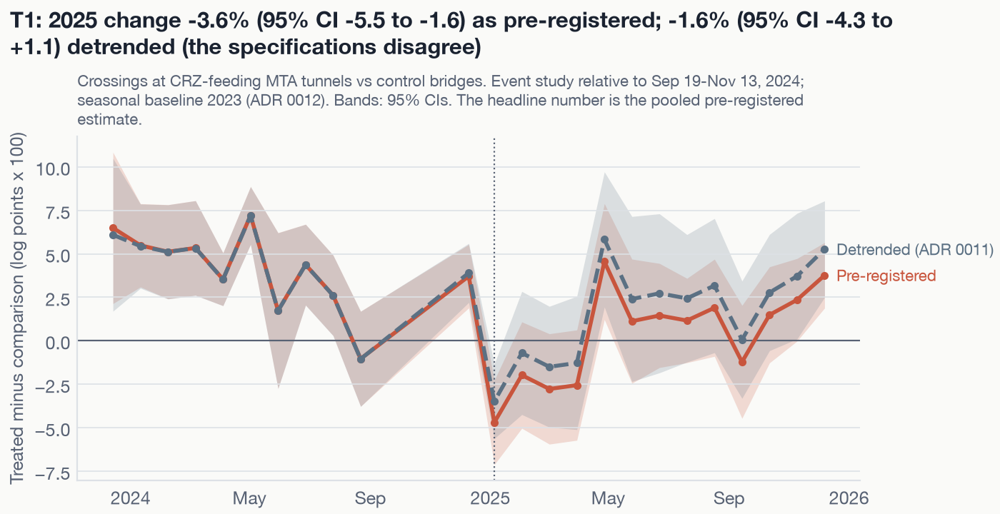

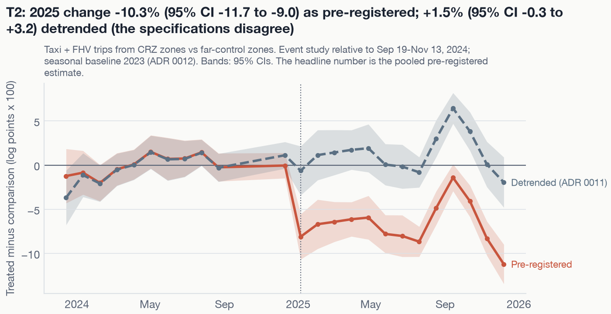

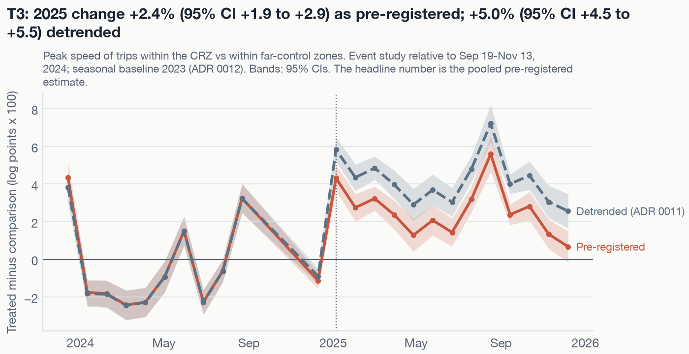

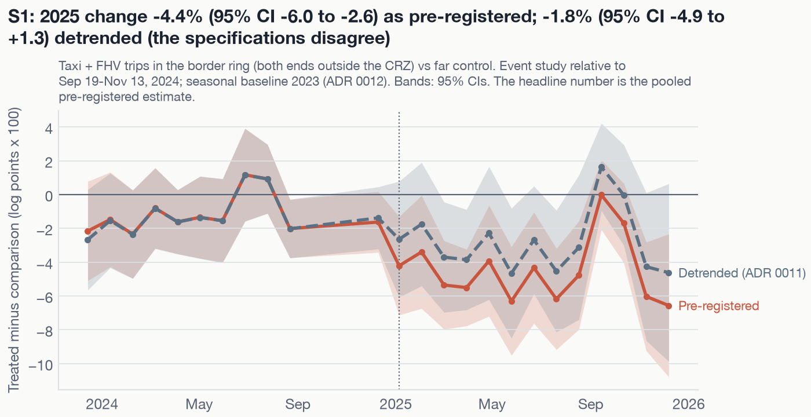

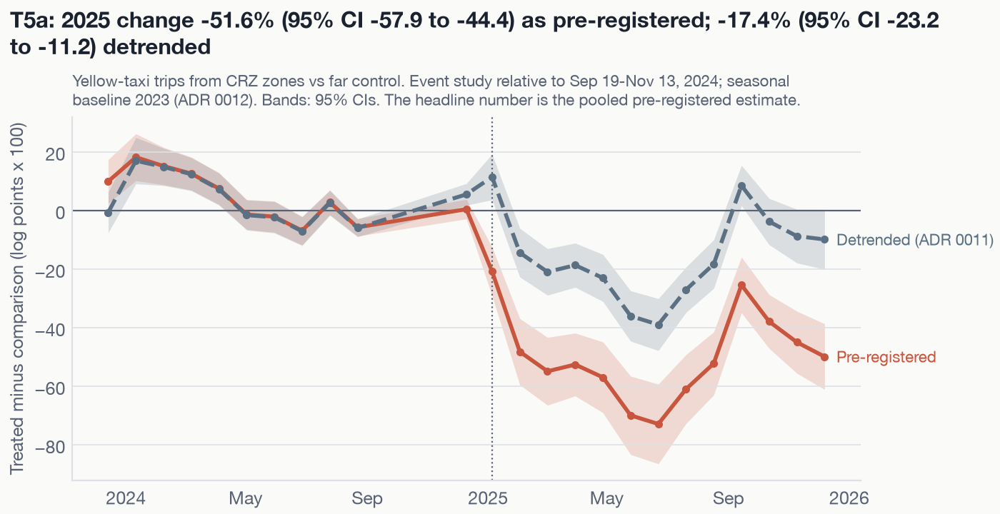

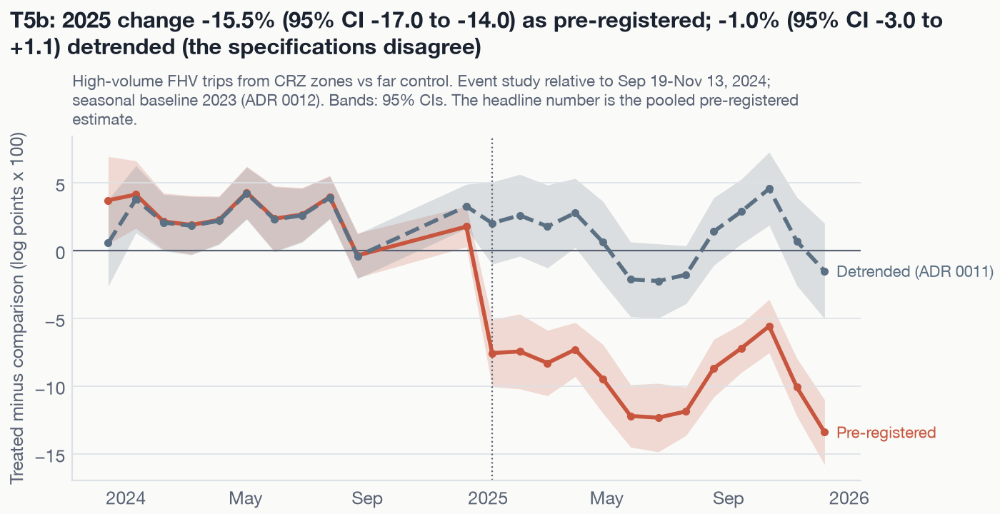

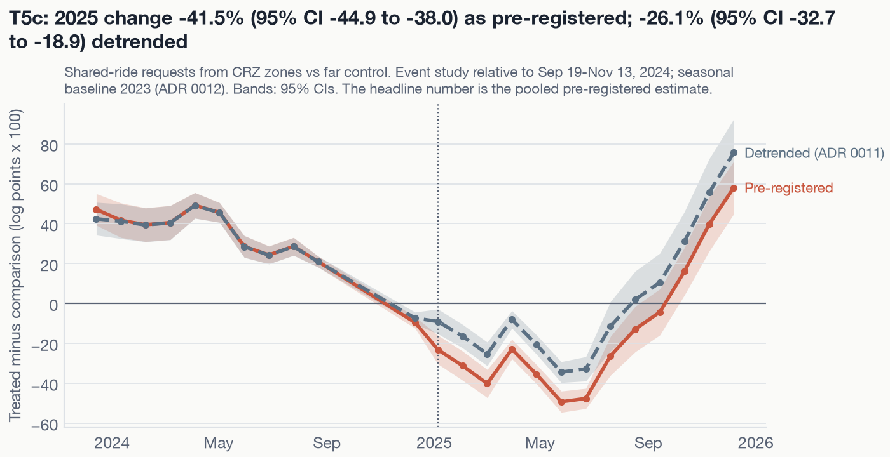

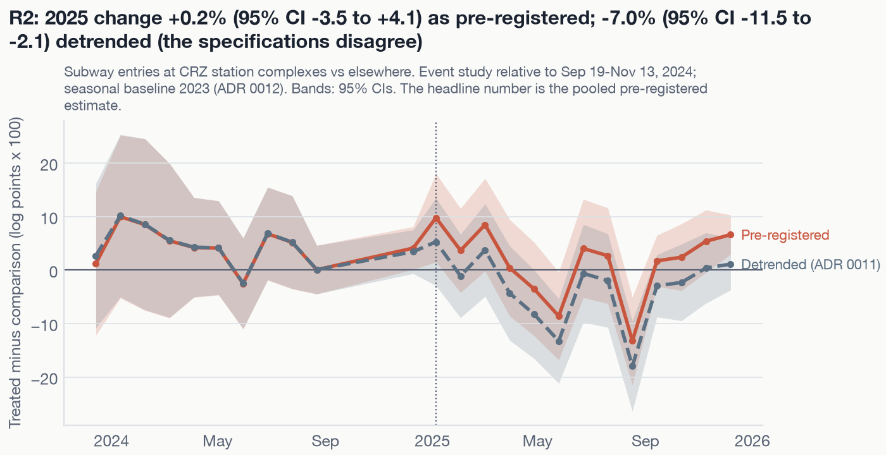

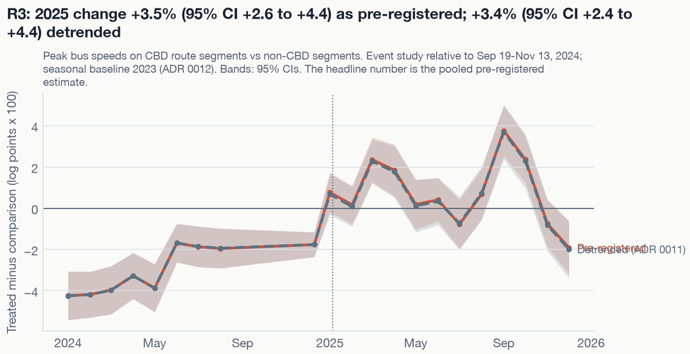

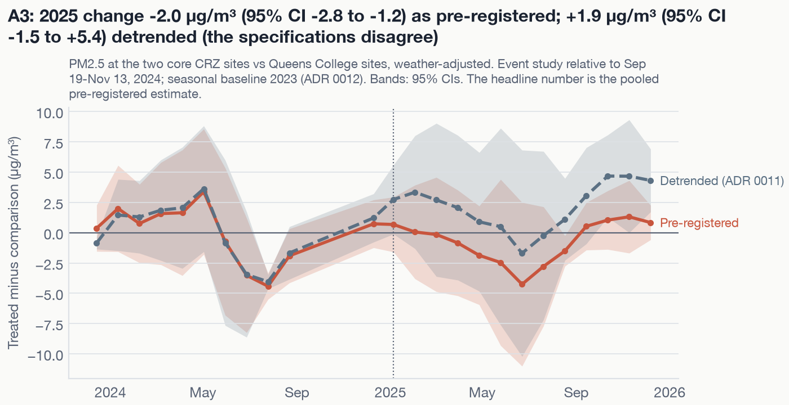

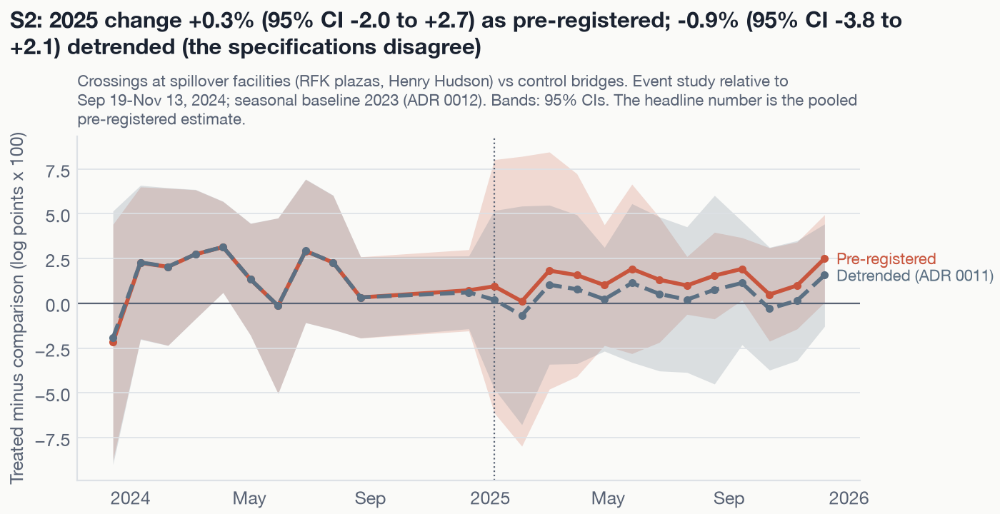

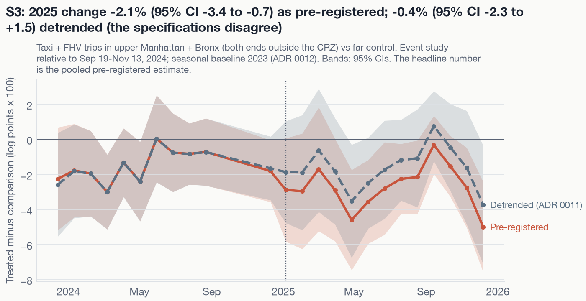

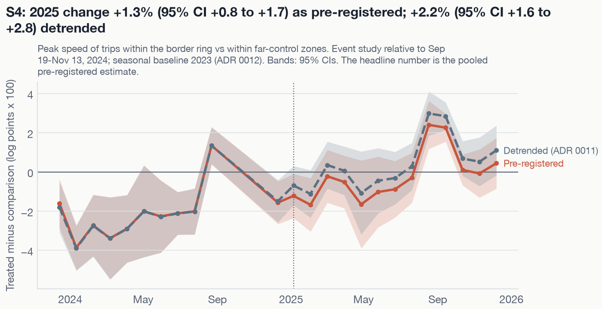

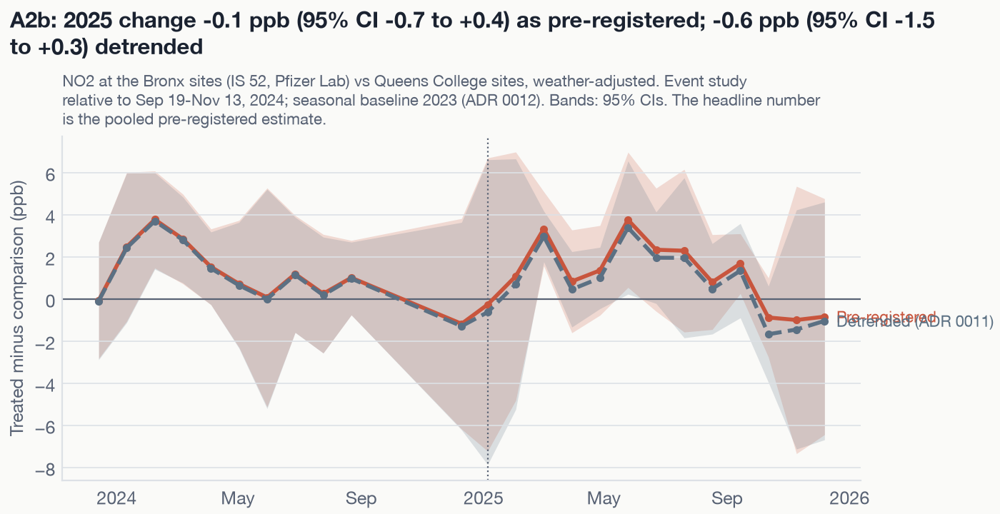

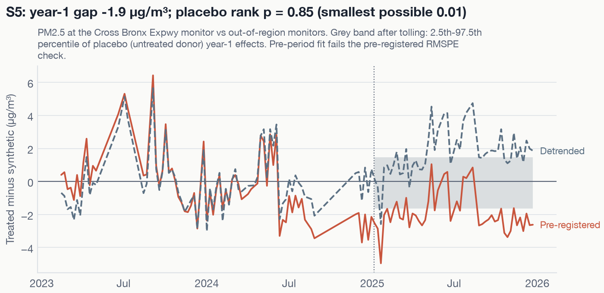

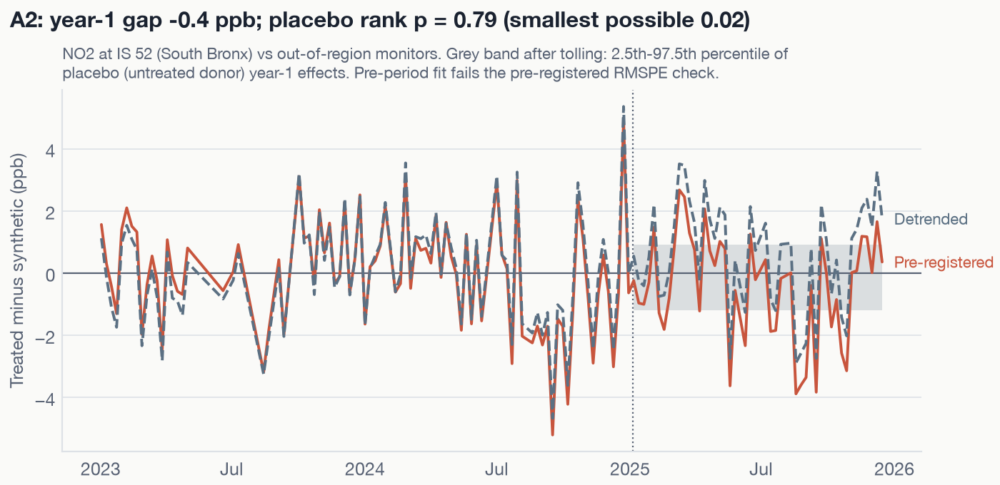

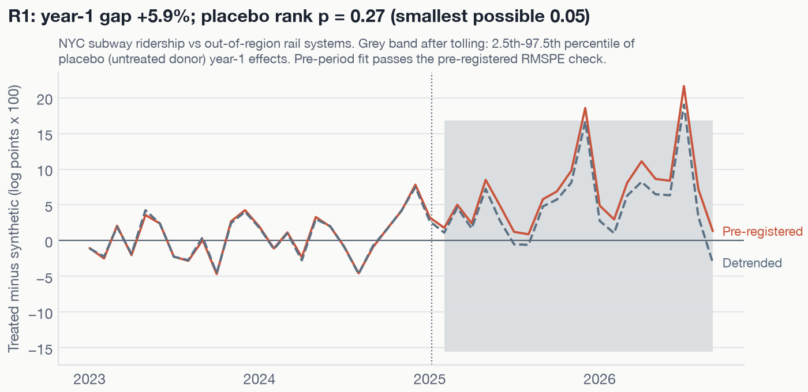

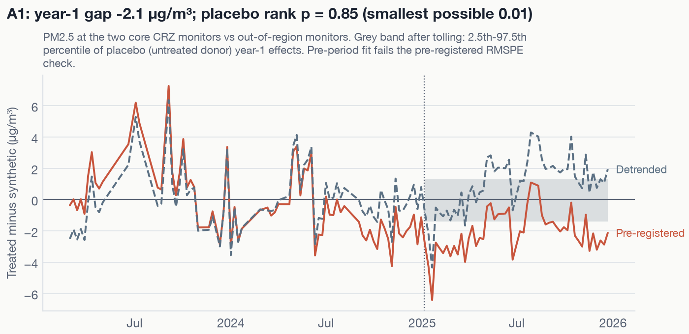

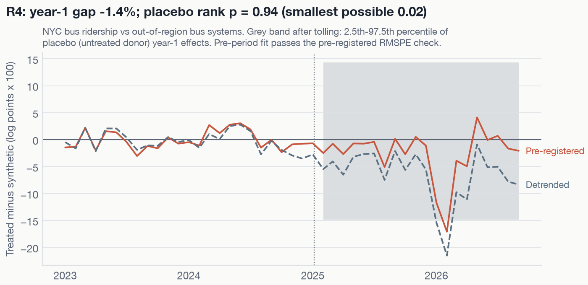

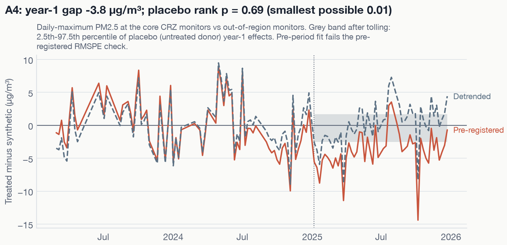
