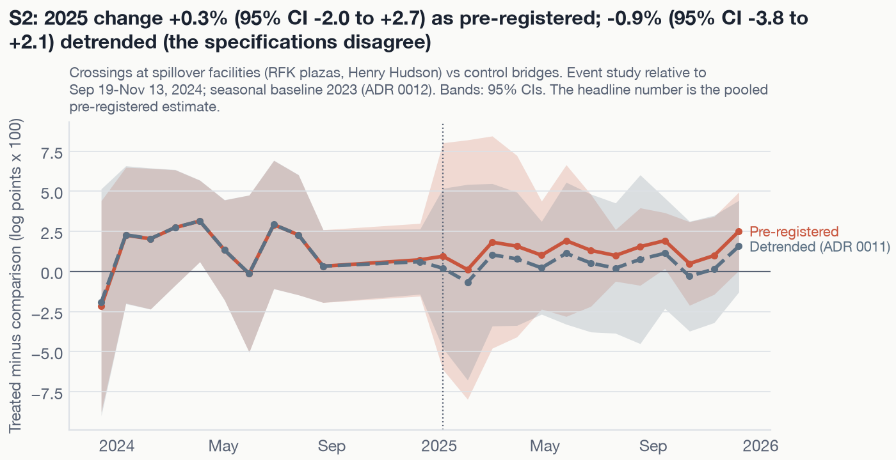
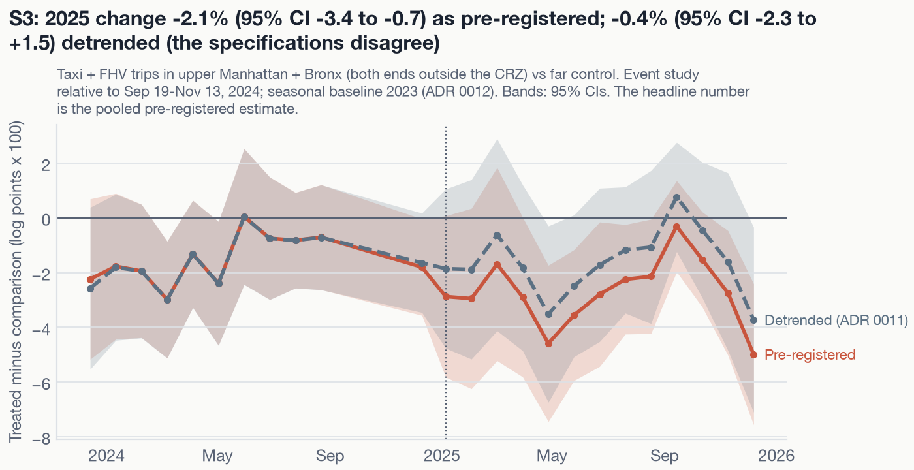
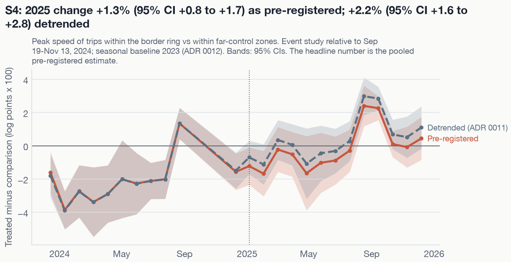
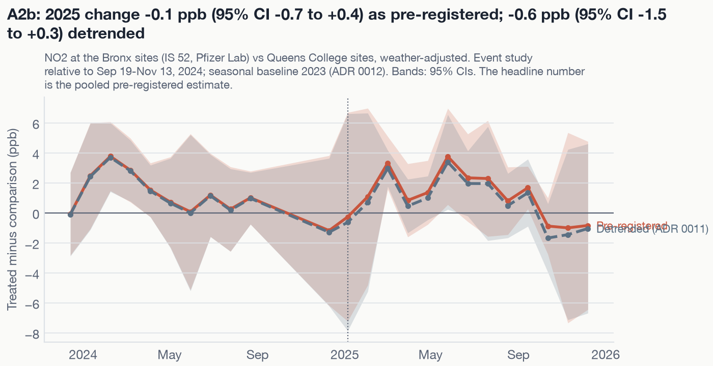
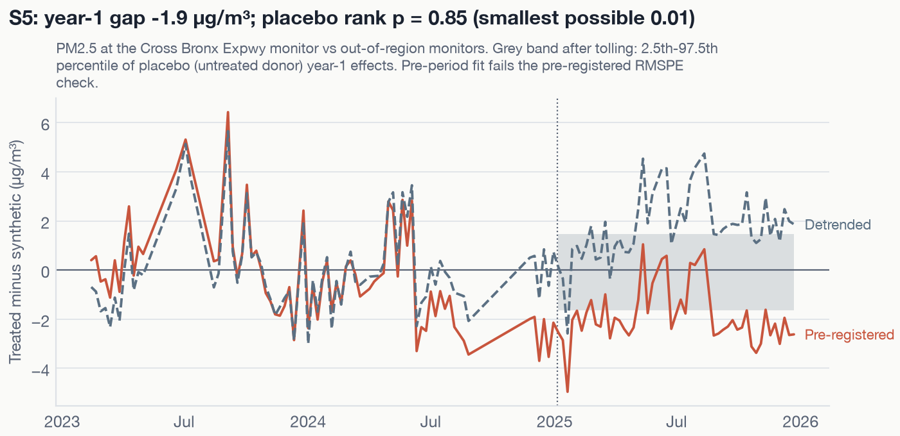
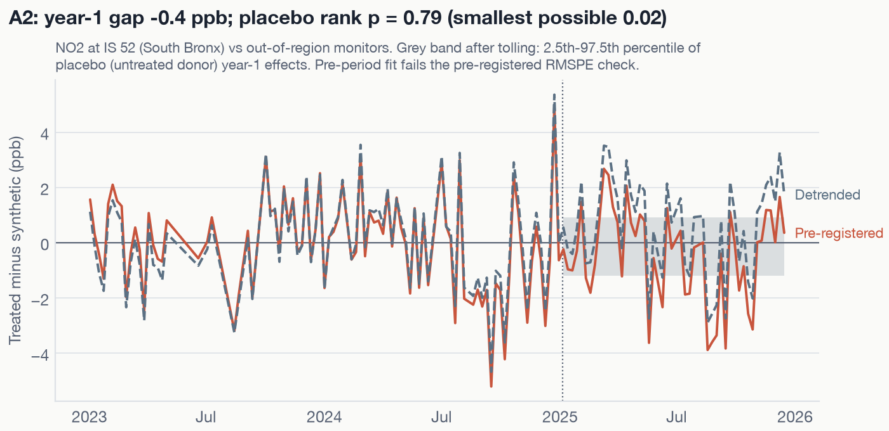
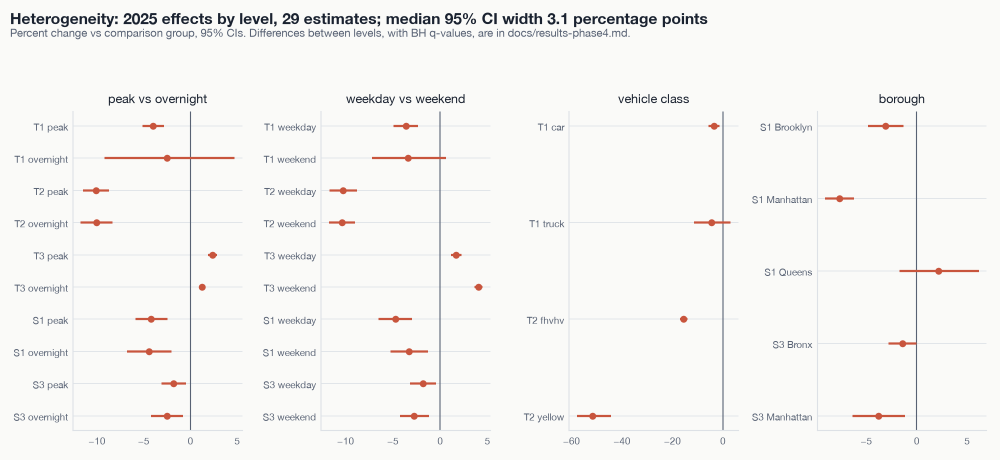
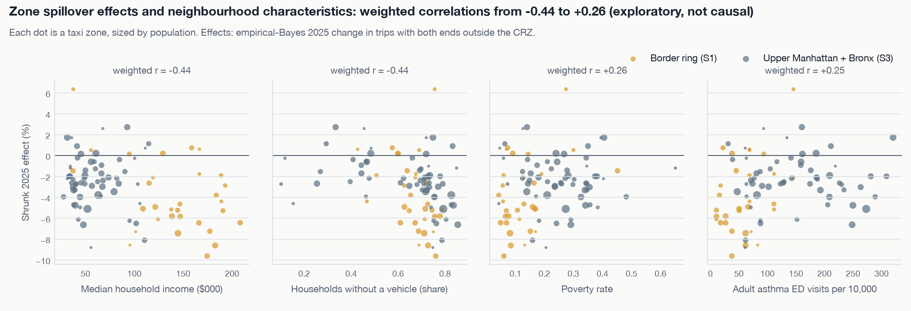

# Phase 4 results: spillovers, heterogeneity, and equity

_Generated by `make analysis` from files in `results/`. Do not edit by hand._

- **Spillover outcomes** (S2-S5, A2) are secondary. Their q-values are Benjamini-Hochberg
  adjusted across that family (analysis plan §5.3; deviation 17). S1, the primary spillover
  outcome, is on the [Phase 3 page](results-phase3.md).
- **Heterogeneity cuts** (§9) are secondary. BH is applied within each cut (deviation 16).
- **Equity associations are exploratory.** They describe how zone-level spillover estimates
  co-vary with neighbourhood characteristics. They are **not causal**: income, car ownership,
  poverty, and asthma rates are tied to distance from the zone, transit access, and trip mix.
- Robust / fragile / not supported labels come in Phase 5.

## Spillover family: BH adjustment

| Outcome | Design | Estimate | p | Method | BH q (family of 5) |
|---|---|---|---|---|---|
| S2 | did | +0.3% | 0.804 | randomization inference (56 assignments) | 0.850 |
| S3 | did | -2.1% | 0.003 | cluster-robust t(151) | 0.009 |
| S4 | did | +1.3% | < 0.001 | cluster-robust t(121) | < 0.001 |
| S5 | synthetic_control | -1.9 µg/m³ | 0.850 | placebo RMSPE-ratio rank | 0.850 |
| A2 | synthetic_control | -0.4 ppb | 0.788 | placebo RMSPE-ratio rank | 0.850 |

## Spillover outcomes: difference-in-differences

| Outcome | Headline, 2025 [95% CI] | p (method) | Detrended [95% CI] | Anticipation [95% CI] | 2026+ [95% CI] | Pre-trend test p (primary / detrended) | Clusters |
|---|---|---|---|---|---|---|---|
| **S2** Crossings at spillover facilities (RFK plazas, Henry Hudson) vs control bridges | +0.3% [-2.0, +2.7] | 0.804 (randomization inference (56 assignments); WCB p = 0.786; cluster-t p = 0.765) | -0.9% [-3.8, +2.1] | -0.1% [-2.7, +2.6] | +0.8% [-2.5, +4.2] | 0.232 / 0.232 | 8 facilities |
| **S3** Taxi + FHV trips in upper Manhattan + Bronx (both ends outside the CRZ) vs far control | -2.1% [-3.4, -0.7] | 0.003 (cluster-robust t(151); WCB p = 0.003) | -0.4% [-2.3, +1.5] | -0.9% [-2.3, +0.6] | -3.9% [-5.8, -1.9] | 0.008 / 0.007 | 152 taxi zones |
| **S4** Peak speed of trips within the border ring vs within far-control zones | +1.3% [+0.8, +1.7] | < 0.001 (cluster-robust t(121); WCB p = < 0.001) | +2.2% [+1.6, +2.8] | -0.4% [-1.0, +0.2] | +0.0% [-0.6, +0.6] | < 0.001 / < 0.001 | 122 taxi zones |
| **A2b** NO2 at the Bronx sites (IS 52, Pfizer Lab) vs Queens College sites, weather-adjusted | -0.1 ppb [-0.7, +0.4] | 0.833 (randomization inference (6 assignments); WCB p = 0.542; cluster-t p = 0.494) | -0.6 ppb [-1.5, +0.3] | -1.5 ppb [-3.3, +0.4] | +0.1 ppb [-1.3, +1.6] | 0.167 / 0.167 | 4 sites |

## Spillover outcomes: synthetic control

| Outcome | Year-1 gap | Placebo p (min possible) | Placebo effect range | Detrended gap (p) | Anticipation gap | 2026+ gap | Pre-RMSPE vs median placebo | Fit check | Donors |
|---|---|---|---|---|---|---|---|---|---|
| **S5** PM2.5 at the Cross Bronx Expwy monitor vs out-of-region monitors | -1.9 µg/m³ | 0.850 (0.010) | -1.6 to +1.5 | +1.7 µg/m³ (0.870) | -2.5 µg/m³ | n/a | 1.98 vs 0.58 | **fail: descriptive only** | 99 (3.3% of cells imputed) |
| **A2** NO2 at IS 52 (South Bronx) vs out-of-region monitors | -0.4 ppb | 0.788 (0.019) | -1.2 to +0.9 | +0.6 ppb (0.827) | -0.4 ppb | n/a | 1.68 vs 0.89 | **fail: descriptive only** | 51 (3.1% of cells imputed) |

## Heterogeneity

Differences are in log points x 100, shown as a percent, for the second level minus the first (the reference). Effects on speeds (T3) are on log mph.

### Peak vs overnight toll hours

| Outcome | Level | Kind | Effect [95% CI] | p (method) | BH q within cut |
|---|---|---|---|---|---|
| T1 | peak | level effect | -4.0% [-5.1, -2.9] | 0.007 (wild cluster bootstrap, Webb (9999 draws)) | n/a |
| T1 | overnight | level effect | -2.5% [-9.2, +4.7] | 0.611 (wild cluster bootstrap, Webb (9999 draws)) | n/a |
| T1 | overnight - peak | difference | +1.6% [-5.1, +8.7] | 0.674 (wild cluster bootstrap, Webb (9999 draws)) | 0.945 |
| T2 | peak | level effect | -10.1% [-11.5, -8.7] | < 0.001 (cluster-robust t(130)) | n/a |
| T2 | overnight | level effect | -10.0% [-11.7, -8.3] | < 0.001 (cluster-robust t(130)) | n/a |
| T2 | overnight - peak | difference | +0.1% [-1.6, +1.7] | 0.945 (cluster-robust t(130)) | 0.945 |
| T3 | peak | level effect | +2.4% [+1.9, +2.9] | < 0.001 (cluster-robust t(128)) | n/a |
| T3 | overnight | level effect | +1.3% [+0.9, +1.6] | < 0.001 (cluster-robust t(128)) | n/a |
| T3 | overnight - peak | difference | -1.1% [-1.5, -0.7] | < 0.001 (cluster-robust t(128)) | < 0.001 |
| S1 | peak | level effect | -4.2% [-5.9, -2.5] | < 0.001 (cluster-robust t(124)) | n/a |
| S1 | overnight | level effect | -4.4% [-6.8, -2.0] | < 0.001 (cluster-robust t(124)) | n/a |
| S1 | overnight - peak | difference | -0.2% [-1.9, +1.5] | 0.782 (cluster-robust t(124)) | 0.945 |
| S3 | peak | level effect | -1.8% [-3.1, -0.5] | 0.009 (cluster-robust t(151)) | n/a |
| S3 | overnight | level effect | -2.5% [-4.2, -0.8] | 0.005 (cluster-robust t(151)) | n/a |
| S3 | overnight - peak | difference | -0.7% [-2.1, +0.6] | 0.278 (cluster-robust t(151)) | 0.695 |

### Weekday vs weekend

| Outcome | Level | Kind | Effect [95% CI] | p (method) | BH q within cut |
|---|---|---|---|---|---|
| T1 | weekday | level effect | -3.6% [-4.9, -2.3] | 0.018 (wild cluster bootstrap, Webb (9999 draws)) | n/a |
| T1 | weekend | level effect | -3.4% [-7.2, +0.6] | 0.062 (wild cluster bootstrap, Webb (9999 draws)) | n/a |
| T1 | weekend - weekday | difference | +0.3% [-2.6, +3.2] | 0.827 (wild cluster bootstrap, Webb (9999 draws)) | 0.827 |
| T2 | weekday | level effect | -10.3% [-11.7, -8.8] | < 0.001 (cluster-robust t(130)) | n/a |
| T2 | weekend | level effect | -10.4% [-11.8, -9.0] | < 0.001 (cluster-robust t(130)) | n/a |
| T2 | weekend - weekday | difference | -0.2% [-1.3, +1.0] | 0.774 (cluster-robust t(130)) | 0.827 |
| T3 | weekday | level effect | +1.7% [+1.1, +2.2] | < 0.001 (cluster-robust t(128)) | n/a |
| T3 | weekend | level effect | +4.1% [+3.6, +4.5] | < 0.001 (cluster-robust t(128)) | n/a |
| T3 | weekend - weekday | difference | +2.3% [+2.0, +2.7] | < 0.001 (cluster-robust t(128)) | < 0.001 |
| S1 | weekday | level effect | -4.7% [-6.5, -3.0] | < 0.001 (cluster-robust t(124)) | n/a |
| S1 | weekend | level effect | -3.3% [-5.3, -1.3] | 0.002 (cluster-robust t(124)) | n/a |
| S1 | weekend - weekday | difference | +1.5% [-0.1, +3.1] | 0.059 (cluster-robust t(124)) | 0.098 |
| S3 | weekday | level effect | -1.8% [-3.2, -0.4] | 0.010 (cluster-robust t(151)) | n/a |
| S3 | weekend | level effect | -2.7% [-4.3, -1.2] | < 0.001 (cluster-robust t(151)) | n/a |
| S3 | weekend - weekday | difference | -0.9% [-1.8, -0.1] | 0.032 (cluster-robust t(151)) | 0.079 |

### Vehicle class

| Outcome | Level | Kind | Effect [95% CI] | p (method) | BH q within cut |
|---|---|---|---|---|---|
| T1 | car | level effect | -3.6% [-5.7, -1.3] | 0.044 (wild cluster bootstrap, Webb (9999 draws)) | n/a |
| T1 | truck | level effect | -4.4% [-11.4, +3.1] | 0.214 (wild cluster bootstrap, Webb (9999 draws)) | n/a |
| T1 | truck - car | difference | -0.9% [-8.1, +6.8] | 0.765 (wild cluster bootstrap, Webb (9999 draws)) | 0.765 |
| T2 | fhvhv | level effect | -15.5% [-17.0, -14.0] | < 0.001 (cluster-robust t(130)) | n/a |
| T2 | yellow | level effect | -51.6% [-57.9, -44.4] | < 0.001 (cluster-robust t(130)) | n/a |
| T2 | yellow - fhvhv | difference | -42.7% [-50.2, -33.9] | < 0.001 (cluster-robust t(130)) | < 0.001 |

### Borough of the treated zones

| Outcome | Level | Kind | Effect [95% CI] | p (method) | BH q within cut |
|---|---|---|---|---|---|
| S1 | Brooklyn | level effect | -3.1% [-4.8, -1.3] | < 0.001 (cluster-robust t(124)) | 0.002 |
| S1 | Manhattan | level effect | -7.7% [-9.1, -6.2] | < 0.001 (cluster-robust t(124)) | < 0.001 |
| S1 | Queens | level effect | +2.1% [-1.7, +6.2] | 0.278 (cluster-robust t(124)) | 0.278 |
| S3 | Bronx | level effect | -1.4% [-2.8, -0.0] | 0.045 (cluster-robust t(151)) | 0.056 |
| S3 | Manhattan | level effect | -3.8% [-6.4, -1.2] | 0.005 (cluster-robust t(151)) | 0.009 |

## Zone-level spillovers and the equity lens (exploratory)

| Group | Zones | Median raw effect | Median shrunk effect | Shrunk 10th-90th percentile | Median placebo SD (log pts x 100) |
|---|---|---|---|---|---|
| Border ring (S1) | 32 | -5.0% | -5.0% | -8.3% to +0.5% | 0.79 |
| Upper Manhattan + Bronx (S3) | 59 | -2.4% | -2.4% | -5.3% to +0.8% | 0.50 |

Empirical-Bayes mean -3.06 log points x 100; between-zone SD (tau) 2.42.

**Associations with neighbourhood characteristics (exploratory, population-weighted; HC1 SEs that ignore the estimation error in the shrunk effects).**

| Model | Covariate | Weighted correlation | Slope per SD (pct points) [95% CI] | p | Zones |
|---|---|---|---|---|---|
| bivariate | Median household income | -0.44 | -1.15 [-1.70, -0.60] | < 0.001 | 88 |
| bivariate | Households without a vehicle (share) | -0.44 | -1.16 [-1.69, -0.63] | < 0.001 | 88 |
| bivariate | Poverty rate | +0.26 | +0.69 [+0.07, +1.31] | 0.030 | 88 |
| bivariate | Adult asthma ED visits per 10,000 (2017-2019) | +0.25 | +0.67 [-0.02, +1.36] | 0.058 | 88 |
| multivariable | Median household income | n/a | -1.13 [-1.92, -0.34] | 0.005 | 88 |
| multivariable | Households without a vehicle (share) | n/a | -1.44 [-2.02, -0.86] | < 0.001 | 88 |
| multivariable | Poverty rate | n/a | +0.14 [-0.77, +1.05] | 0.763 | 88 |
| multivariable | Adult asthma ED visits per 10,000 (2017-2019) | n/a | +0.17 [-0.59, +0.94] | 0.662 | 88 |

## Figures

