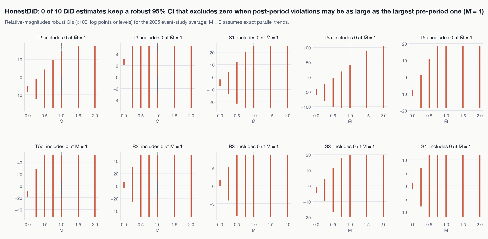

# Phase 5 results: robustness and claim labels

_Generated by `make analysis` from files in `results/`. Do not edit by hand._

Each claim gets one label (analysis plan §8; deviations 18-23):
- **robust**: significant after the pre-registered multiplicity adjustment, and every check
  passes. That includes HonestDiD breakdown M̄ ≥ 1 for DiD; placebo p ≤ 0.10 and leave-one-out
  for synthetic control; and agreement with the detrended specification for T2, R4, A1, A3, R2.
- **fragile**: significant, but at least one condition fails. Every failure is listed.
- **not supported**: not significant after adjustment, or a synthetic control whose pre-period
  fit fails (descriptive only).

Pass rules for each check were fixed before any check was run (deviation 18).

## Claim labels

| Outcome | Estimate (2025) | Adjusted p | Breakdown M̄ | Label | Why |
|---|---|---|---|---|---|
| **A1** PM2.5 at the two core CRZ monitors vs out-of-region monitors | -2.1 µg/m³ | 0.850 (Holm (6 primary outcomes)) | n/a | **not supported** | descriptive only: pre-period fit fails the RMSPE check |
| **R1** NYC subway ridership vs out-of-region rail systems | +5.9% | 0.545 (Holm (6 primary outcomes)) | n/a | **not supported** | no interval for synthetic control; see the placebo range and MDE |
| **S1** Taxi + FHV trips in the border ring (both ends outside the CRZ) vs far control | -4.4% | < 0.001 (Holm (6 primary outcomes)) | ≤ 0.25 | **fragile** | breakdown M̄ ≤ 0.25, below the required 1 (pre-trend p = 0.000328) |
| **T1** Crossings at CRZ-feeding MTA tunnels vs control bridges | -3.6% | 0.143 (Holm (6 primary outcomes)) | not computed | **not supported** | pre-registered p = 0.048 (randomization inference (21 assignments)); the cluster-robust interval -5.5% to -1.6% is not reliable with 7 clusters, so no range is claimed as ruled out |
| **T2** Taxi + FHV trips from CRZ zones vs far-control zones | -10.3% | < 0.001 (Holm (6 primary outcomes)) | 0.25-0.5 | **fragile** | placebo date 2024-01-07 fails; breakdown M̄ 0.25-0.5, below the required 1 (pre-trend p = 4.87e-06); detrended specification disagrees (amendment 1) |
| **T3** Peak speed of trips within the CRZ vs within far-control zones | +2.4% | < 0.001 (Holm (6 primary outcomes)) | ≤ 0.25 | **fragile** | placebo date 2024-01-07 fails; breakdown M̄ ≤ 0.25, below the required 1 (pre-trend p = 6.91e-59) |
| **A2** NO2 at IS 52 (South Bronx) vs out-of-region monitors | -0.4 ppb | 0.850 (BH within spillover (5 outcomes)) | n/a | **not supported** | descriptive only: pre-period fit fails the RMSPE check |
| **A3** PM2.5 at the two core CRZ sites vs Queens College sites, weather-adjusted | -2.0 µg/m³ | 0.667 (BH within air (2 outcomes)) | not computed | **not supported** | pre-registered p = 0.333 (randomization inference (6 assignments)); the cluster-robust interval -2.8 µg/m³ to -1.2 µg/m³ is not reliable with 4 clusters, so no range is claimed as ruled out |
| **A4** Daily-maximum PM2.5 at the core CRZ monitors vs out-of-region monitors | -3.8 µg/m³ | 0.690 (BH within air (2 outcomes)) | n/a | **not supported** | descriptive only: pre-period fit fails the RMSPE check |
| **R2** Subway entries at CRZ station complexes vs elsewhere | +0.2% | 0.940 (BH within transit (3 outcomes)) | ≤ 0.25 | **not supported** | 95% CI -3.5% to +4.1%; effects outside it are ruled out at 95% (unadjusted) |
| **R3** Peak bus speeds on CBD route segments vs non-CBD segments | +3.5% | < 0.001 (BH within transit (3 outcomes)) | ≤ 0.25 | **fragile** | breakdown M̄ ≤ 0.25, below the required 1 (pre-trend p = 2.38e-12) |
| **R4** NYC bus ridership vs out-of-region bus systems | -1.4% | 0.940 (BH within transit (3 outcomes)) | n/a | **not supported** | no interval for synthetic control; see the placebo range and MDE |
| **S2** Crossings at spillover facilities (RFK plazas, Henry Hudson) vs control bridges | +0.3% | 0.850 (BH within spillover (5 outcomes)) | not computed | **not supported** | pre-registered p = 0.804 (randomization inference (56 assignments)); the cluster-robust interval -2.0% to +2.7% is not reliable with 8 clusters, so no range is claimed as ruled out |
| **S3** Taxi + FHV trips in upper Manhattan + Bronx (both ends outside the CRZ) vs far control | -2.1% | 0.009 (BH within spillover (5 outcomes)) | ≤ 0.25 | **fragile** | breakdown M̄ ≤ 0.25, below the required 1 (pre-trend p = 0.0077) |
| **S4** Peak speed of trips within the border ring vs within far-control zones | +1.3% | < 0.001 (BH within spillover (5 outcomes)) | ≤ 0.25 | **fragile** | breakdown M̄ ≤ 0.25, below the required 1 (pre-trend p = 5.48e-28) |
| **S5** PM2.5 at the Cross Bronx Expwy monitor vs out-of-region monitors | -1.9 µg/m³ | 0.850 (BH within spillover (5 outcomes)) | n/a | **not supported** | descriptive only: pre-period fit fails the RMSPE check |
| **T5a** Yellow-taxi trips from CRZ zones vs far control | -51.6% | < 0.001 (BH within traffic (3 outcomes)) | 0.5-0.75 | **fragile** | breakdown M̄ 0.5-0.75, below the required 1 (pre-trend p = 6.4e-13) |
| **T5b** High-volume FHV trips from CRZ zones vs far control | -15.5% | < 0.001 (BH within traffic (3 outcomes)) | ≤ 0.25 | **fragile** | placebo date 2024-01-07 fails; breakdown M̄ ≤ 0.25, below the required 1 (pre-trend p = 1.25e-14) |
| **T5c** Shared-ride requests from CRZ zones vs far control | -41.5% | < 0.001 (BH within traffic (3 outcomes)) | ≤ 0.25 | **fragile** | breakdown M̄ ≤ 0.25, below the required 1 (pre-trend p = 1.98e-42) |

## HonestDiD sensitivity (Rambachan & Roth 2023)

Target: the average of the 2025 event-study bins, relative to the reference window (Sep 19-Nov 13, 2024). Because the baseline differs, it can differ from the pooled headline. 'original' assumes exact parallel trends. Intervals that reach the edge of the port's search grid are at least as wide as shown. Smoothness M values are multiples (0, 0.5, 1, 2) of the largest absolute second difference of the pre-period bins (deviation 18e).

| Outcome | Restriction | Parameter | 95% robust CI (log points or levels) | Note |
|---|---|---|---|---|
| T1 | relative_magnitudes | n/a | n/a | not computed: 7 clusters give a singular covariance (deviation 18d) |
| T2 | original | n/a | [-0.0845, -0.0504] |  |
| T2 | relative_magnitudes | 0.25 | [-0.1249, -0.0096] |  |
| T2 | relative_magnitudes | 0.5 | [-0.1740, +0.0430] |  |
| T2 | relative_magnitudes | 0.75 | [-0.1740, +0.0956] |  |
| T2 | relative_magnitudes | 1 | [-0.1740, +0.1486] |  |
| T2 | relative_magnitudes | 1.5 | [-0.1740, +0.1740] |  |
| T2 | relative_magnitudes | 2 | [-0.1740, +0.1740] |  |
| T2 | smoothness | 0 | [-0.1056, -0.0634] |  |
| T2 | smoothness | 0.013558 | [-0.6104, +0.5213] |  |
| T2 | smoothness | 0.027116 | [-1.1342, +0.9644] |  |
| T2 | smoothness | 0.054231 | [-2.0833, +1.9134] |  |
| T3 | original | n/a | [+0.0205, +0.0310] |  |
| T3 | relative_magnitudes | 0.25 | [-0.0538, +0.0538] |  |
| T3 | relative_magnitudes | 0.5 | [-0.0538, +0.0538] |  |
| T3 | relative_magnitudes | 0.75 | [-0.0538, +0.0538] |  |
| T3 | relative_magnitudes | 1 | [-0.0538, +0.0538] |  |
| T3 | relative_magnitudes | 1.5 | [-0.0538, +0.0538] |  |
| T3 | relative_magnitudes | 2 | [-0.0538, +0.0538] |  |
| S1 | original | n/a | [-0.0693, -0.0204] |  |
| S1 | relative_magnitudes | 0.25 | [-0.1343, +0.0438] |  |
| S1 | relative_magnitudes | 0.5 | [-0.2148, +0.1238] |  |
| S1 | relative_magnitudes | 0.75 | [-0.2498, +0.2058] |  |
| S1 | relative_magnitudes | 1 | [-0.2498, +0.2498] |  |
| S1 | relative_magnitudes | 1.5 | [-0.2498, +0.2498] |  |
| S1 | relative_magnitudes | 2 | [-0.2498, +0.2498] |  |
| T5a | original | n/a | [-0.6002, -0.3957] |  |
| T5a | relative_magnitudes | 0.25 | [-0.7946, -0.2328] |  |
| T5a | relative_magnitudes | 0.5 | [-1.0222, -0.0240] |  |
| T5a | relative_magnitudes | 0.75 | [-1.0431, +0.1869] |  |
| T5a | relative_magnitudes | 1 | [-1.0431, +0.4062] |  |
| T5a | relative_magnitudes | 1.5 | [-1.0431, +0.8635] |  |
| T5a | relative_magnitudes | 2 | [-1.0431, +1.0431] |  |
| T5b | original | n/a | [-0.1115, -0.0753] |  |
| T5b | relative_magnitudes | 0.25 | [-0.1848, +0.0105] |  |
| T5b | relative_magnitudes | 0.5 | [-0.1848, +0.1101] |  |
| T5b | relative_magnitudes | 0.75 | [-0.1848, +0.1848] |  |
| T5b | relative_magnitudes | 1 | [-0.1848, +0.1848] |  |
| T5b | relative_magnitudes | 1.5 | [-0.1848, +0.1848] |  |
| T5b | relative_magnitudes | 2 | [-0.1848, +0.1848] |  |
| T5c | original | n/a | [-0.1895, -0.0868] |  |
| T5c | relative_magnitudes | 0.25 | [-0.5236, +0.2909] |  |
| T5c | relative_magnitudes | 0.5 | [-0.5236, +0.5236] |  |
| T5c | relative_magnitudes | 0.75 | [-0.5236, +0.5236] |  |
| T5c | relative_magnitudes | 1 | [-0.5236, +0.5236] |  |
| T5c | relative_magnitudes | 1.5 | [-0.5236, +0.5236] |  |
| T5c | relative_magnitudes | 2 | [-0.5236, +0.5236] |  |
| R2 | original | n/a | [-0.0334, +0.0636] |  |
| R2 | relative_magnitudes | 0.25 | [-0.2500, +0.2966] |  |
| R2 | relative_magnitudes | 0.5 | [-0.4946, +0.4946] |  |
| R2 | relative_magnitudes | 0.75 | [-0.4946, +0.4946] |  |
| R2 | relative_magnitudes | 1 | [-0.4946, +0.4946] |  |
| R2 | relative_magnitudes | 1.5 | [-0.4946, +0.4946] |  |
| R2 | relative_magnitudes | 2 | [-0.4946, +0.4946] |  |
| R2 | smoothness | 0 | [-0.1796, +0.0012] |  |
| R2 | smoothness | 0.079883 | [-3.0546, +3.0927] |  |
| R2 | smoothness | 0.159765 | [-5.8504, +5.8886] |  |
| R2 | smoothness | 0.319531 | [-11.4423, +11.4804] |  |
| R3 | original | n/a | [-0.0010, +0.0162] |  |
| R3 | relative_magnitudes | 0.25 | [-0.0413, +0.0533] |  |
| R3 | relative_magnitudes | 0.5 | [-0.0861, +0.0875] |  |
| R3 | relative_magnitudes | 0.75 | [-0.0875, +0.0875] |  |
| R3 | relative_magnitudes | 1 | [-0.0875, +0.0875] |  |
| R3 | relative_magnitudes | 1.5 | [-0.0875, +0.0875] |  |
| R3 | relative_magnitudes | 2 | [-0.0875, +0.0875] |  |
| A3 | relative_magnitudes | n/a | n/a | not computed: 4 clusters give a singular covariance (deviation 18d) |
| S2 | relative_magnitudes | n/a | n/a | not computed: 8 clusters give a singular covariance (deviation 18d) |
| S3 | original | n/a | [-0.0466, -0.0078] |  |
| S3 | relative_magnitudes | 0.25 | [-0.0996, +0.0457] |  |
| S3 | relative_magnitudes | 0.5 | [-0.1653, +0.1115] |  |
| S3 | relative_magnitudes | 0.75 | [-0.1978, +0.1780] |  |
| S3 | relative_magnitudes | 1 | [-0.1978, +0.1978] |  |
| S3 | relative_magnitudes | 1.5 | [-0.1978, +0.1978] |  |
| S3 | relative_magnitudes | 2 | [-0.1978, +0.1978] |  |
| S4 | original | n/a | [-0.0134, +0.0098] |  |
| S4 | relative_magnitudes | 0.25 | [-0.0796, +0.0691] |  |
| S4 | relative_magnitudes | 0.5 | [-0.1188, +0.1188] |  |
| S4 | relative_magnitudes | 0.75 | [-0.1188, +0.1188] |  |
| S4 | relative_magnitudes | 1 | [-0.1188, +0.1188] |  |
| S4 | relative_magnitudes | 1.5 | [-0.1188, +0.1188] |  |
| S4 | relative_magnitudes | 2 | [-0.1188, +0.1188] |  |
| A2b | relative_magnitudes | n/a | n/a | not computed: 4 clusters give a singular covariance (deviation 18d) |

## Falsification and re-estimation checks

Estimates are on the model scale: log points for logs, levels for pollution.

| Outcome | Check | Kind | Estimate | Primary | 95% CI / range | p | Passes |
|---|---|---|---|---|---|---|---|
| T1 | placebo date 2024-01-07 | placebo | -0.0129 | -0.0364 | [-0.0320, +0.0062] | 0.193 | yes |
| T1 | placebo outcome: Verrazzano-Narrows | placebo | -0.0100 | -0.0364 | [-0.0215, +0.0016] | 0.351 | yes |
| T1 | June 2024 pause dropped | re-estimation | -0.0381 | -0.0364 | [-0.0592, -0.0170] | 0.038 | yes |
| T1 | holiday weeks dropped | re-estimation | -0.0358 | -0.0364 | [-0.0600, -0.0117] | 0.037 | yes |
| T1 | did2s imputation estimator | re-estimation | -0.0354 | -0.0364 | [-0.0498, -0.0210] | < 0.001 | yes |
| T1 | dose-response: |overnight| <= |peak| | dose-response | -0.0252 | -0.0408 | n/a | n/a | yes |
| T2 | placebo date 2024-01-07 | placebo | -0.0784 | -0.1091 | [-0.0930, -0.0639] | < 0.001 | **no** |
| T2 | placebo outcome: Staten Island trips | placebo | +0.0132 | -0.1091 | [-0.0056, +0.0320] | 0.166 | yes |
| T2 | June 2024 pause dropped | re-estimation | -0.1140 | -0.1091 | [-0.1301, -0.0980] | < 0.001 | yes |
| T2 | holiday weeks dropped | re-estimation | -0.0991 | -0.1091 | [-0.1143, -0.0839] | < 0.001 | yes |
| T2 | did2s imputation estimator | re-estimation | -0.1095 | -0.1091 | [-0.1246, -0.0944] | < 0.001 | yes |
| T2 | control: Brooklyn far zones only | re-estimation | -0.0894 | -0.1091 | [-0.1130, -0.0657] | < 0.001 | yes |
| T2 | control: Queens far zones only | re-estimation | -0.1140 | -0.1091 | [-0.1305, -0.0975] | < 0.001 | yes |
| T2 | control: intermediate band | re-estimation | -0.0777 | -0.1091 | [-0.0956, -0.0598] | < 0.001 | yes |
| T3 | placebo date 2024-01-07 | placebo | -0.0162 | +0.0233 | [-0.0196, -0.0127] | < 0.001 | **no** |
| T3 | June 2024 pause dropped | re-estimation | +0.0232 | +0.0233 | [+0.0182, +0.0282] | < 0.001 | yes |
| T3 | holiday weeks dropped | re-estimation | +0.0211 | +0.0233 | [+0.0163, +0.0259] | < 0.001 | yes |
| T3 | did2s imputation estimator | re-estimation | n/a | +0.0233 | n/a | n/a | n/a |
| T3 | control: Brooklyn far zones only | re-estimation | +0.0229 | +0.0233 | [+0.0177, +0.0282] | < 0.001 | yes |
| T3 | control: Queens far zones only | re-estimation | +0.0279 | +0.0233 | [+0.0223, +0.0334] | < 0.001 | yes |
| T3 | control: intermediate band | re-estimation | +0.0151 | +0.0233 | [+0.0102, +0.0201] | < 0.001 | yes |
| T3 | no 20-trip minimum (unweighted) | re-estimation | +0.0221 | +0.0233 | [+0.0171, +0.0271] | < 0.001 | yes |
| T3 | dose-response: |overnight| <= |peak| | dose-response | +0.0124 | +0.0233 | n/a | n/a | yes |
| S1 | placebo date 2024-01-07 | placebo | -0.0159 | -0.0445 | [-0.0350, +0.0031] | 0.101 | yes |
| S1 | placebo outcome: Staten Island trips | placebo | +0.0132 | -0.0445 | [-0.0056, +0.0320] | 0.166 | yes |
| S1 | June 2024 pause dropped | re-estimation | -0.0455 | -0.0445 | [-0.0640, -0.0270] | < 0.001 | yes |
| S1 | holiday weeks dropped | re-estimation | -0.0415 | -0.0445 | [-0.0588, -0.0241] | < 0.001 | yes |
| S1 | did2s imputation estimator | re-estimation | n/a | -0.0445 | n/a | n/a | n/a |
| S1 | control: Brooklyn far zones only | re-estimation | -0.0248 | -0.0445 | [-0.0504, +0.0009] | 0.058 | yes |
| S1 | control: Queens far zones only | re-estimation | -0.0494 | -0.0445 | [-0.0685, -0.0303] | < 0.001 | yes |
| S1 | control: intermediate band | re-estimation | -0.0131 | -0.0445 | [-0.0335, +0.0072] | 0.202 | yes |
| T5a | placebo date 2024-01-07 | placebo | -0.3478 | -0.7251 | [-0.4312, -0.2644] | < 0.001 | yes |
| T5a | June 2024 pause dropped | re-estimation | -0.7489 | -0.7251 | [-0.8932, -0.6047] | < 0.001 | yes |
| T5a | holiday weeks dropped | re-estimation | -0.7104 | -0.7251 | [-0.8459, -0.5750] | < 0.001 | yes |
| T5a | did2s imputation estimator | re-estimation | -0.7284 | -0.7251 | [-0.8654, -0.5913] | < 0.001 | yes |
| T5b | placebo date 2024-01-07 | placebo | -0.1011 | -0.1689 | [-0.1186, -0.0837] | < 0.001 | **no** |
| T5b | June 2024 pause dropped | re-estimation | -0.1746 | -0.1689 | [-0.1930, -0.1562] | < 0.001 | yes |
| T5b | holiday weeks dropped | re-estimation | -0.1592 | -0.1689 | [-0.1767, -0.1418] | < 0.001 | yes |
| T5b | did2s imputation estimator | re-estimation | -0.1693 | -0.1689 | [-0.1866, -0.1519] | < 0.001 | yes |
| T5c | placebo date 2024-01-07 | placebo | -0.1525 | -0.5365 | [-0.1984, -0.1066] | < 0.001 | yes |
| T5c | June 2024 pause dropped | re-estimation | -0.5313 | -0.5365 | [-0.5917, -0.4710] | < 0.001 | yes |
| T5c | holiday weeks dropped | re-estimation | -0.5682 | -0.5365 | [-0.6284, -0.5080] | < 0.001 | yes |
| T5c | did2s imputation estimator | re-estimation | -0.5179 | -0.5365 | [-0.5774, -0.4583] | < 0.001 | yes |
| R2 | placebo date 2024-01-07 | placebo | +0.0458 | +0.0020 | [+0.0246, +0.0670] | < 0.001 | **no** |
| R2 | June 2024 pause dropped | re-estimation | +0.0055 | +0.0020 | [-0.0335, +0.0446] | 0.781 | yes |
| R2 | holiday weeks dropped | re-estimation | -0.0058 | +0.0020 | [-0.0408, +0.0292] | 0.745 | **no** |
| R2 | did2s imputation estimator | re-estimation | +0.0035 | +0.0020 | [-0.0352, +0.0421] | 0.861 | yes |
| R3 | placebo date 2024-01-07 | placebo | +0.0008 | +0.0343 | [-0.0037, +0.0052] | 0.740 | yes |
| R3 | June 2024 pause dropped | re-estimation | +0.0354 | +0.0343 | [+0.0269, +0.0439] | < 0.001 | yes |
| R3 | did2s imputation estimator | re-estimation | n/a | +0.0343 | n/a | n/a | n/a |
| A3 | placebo date 2024-01-07 | placebo | -2.7252 | -2.0125 | [-5.2198, -0.2307] | 0.050 | yes |
| A3 | June 2024 pause dropped | re-estimation | -2.1218 | -2.0125 | [-2.8661, -1.3775] | 0.046 | yes |
| A3 | holiday weeks dropped | re-estimation | -2.0656 | -2.0125 | [-3.1109, -1.0203] | 0.053 | yes |
| A3 | smoke days included | re-estimation | -2.7499 | -2.0125 | [-4.9179, -0.5820] | 0.056 | yes |
| A3 | Queens College Near Road added | re-estimation | -1.9209 | -2.0125 | [-2.3900, -1.4519] | 0.018 | yes |
| S2 | placebo date 2024-01-07 | placebo | +0.0079 | +0.0031 | [-0.0224, +0.0383] | 0.585 | yes |
| S2 | June 2024 pause dropped | re-estimation | +0.0028 | +0.0031 | [-0.0236, +0.0293] | 0.810 | yes |
| S2 | holiday weeks dropped | re-estimation | +0.0032 | +0.0031 | [-0.0175, +0.0240] | 0.769 | yes |
| S2 | did2s imputation estimator | re-estimation | n/a | +0.0031 | n/a | n/a | n/a |
| S3 | placebo date 2024-01-07 | placebo | -0.0111 | -0.0210 | [-0.0249, +0.0028] | 0.116 | yes |
| S3 | June 2024 pause dropped | re-estimation | -0.0210 | -0.0210 | [-0.0357, -0.0063] | 0.005 | yes |
| S3 | holiday weeks dropped | re-estimation | -0.0188 | -0.0210 | [-0.0334, -0.0042] | 0.012 | yes |
| S3 | did2s imputation estimator | re-estimation | -0.0214 | -0.0210 | [-0.0351, -0.0077] | 0.002 | yes |
| S4 | placebo date 2024-01-07 | placebo | -0.0061 | +0.0127 | [-0.0098, -0.0025] | 0.001 | yes |
| S4 | June 2024 pause dropped | re-estimation | +0.0126 | +0.0127 | [+0.0079, +0.0173] | < 0.001 | yes |
| S4 | holiday weeks dropped | re-estimation | +0.0124 | +0.0127 | [+0.0078, +0.0169] | < 0.001 | yes |
| S4 | did2s imputation estimator | re-estimation | n/a | +0.0127 | n/a | n/a | n/a |
| A2b | placebo date 2024-01-07 | placebo | +0.2025 | -0.1430 | [-0.7694, +1.1744] | 0.559 | yes |
| A2b | June 2024 pause dropped | re-estimation | -0.2852 | -0.1430 | [-0.8799, +0.3094] | 0.148 | yes |
| A2b | holiday weeks dropped | re-estimation | +0.0401 | -0.1430 | [-1.0790, +1.1591] | 0.894 | **no** |
| S5 | leave-one-out donors (5 with weight > 0) | re-estimation | -2.0670 | -1.8952 | [n/a, -1.3966] | n/a | yes |
| S5 | placebo date 2024-01-07 (pre-period only) | placebo | -1.4518 | -1.8952 | n/a | n/a | **no** |
| A2 | leave-one-out donors (7 with weight > 0) | re-estimation | -0.4570 | -0.4280 | [n/a, -0.4036] | n/a | yes |
| A2 | placebo date 2024-01-07 (pre-period only) | placebo | -0.6391 | -0.4280 | n/a | n/a | **no** |
| R1 | leave-one-out donors (9 with weight > 0) | re-estimation | +0.0284 | +0.0575 | [n/a, +0.1004] | n/a | yes |
| R1 | placebo date 2024-01-07 (pre-period only) | placebo | -0.0472 | +0.0575 | n/a | n/a | **no** |
| A1 | leave-one-out donors (5 with weight > 0) | re-estimation | -2.1760 | -2.1417 | [n/a, -1.8016] | n/a | yes |
| A1 | placebo date 2024-01-07 (pre-period only) | placebo | -1.8806 | -2.1417 | n/a | n/a | **no** |
| A1 | all five CRZ sites (>= 2 valid per week) | re-estimation | -1.5824 | -2.1417 | n/a | n/a | yes |
| A1 | smoke days included | re-estimation | -2.5048 | -2.1417 | n/a | n/a | yes |
| A1 | donors >= 98% complete | re-estimation | -2.2205 | -2.1417 | n/a | n/a | yes |
| R4 | leave-one-out donors (5 with weight > 0) | re-estimation | -0.0199 | -0.0139 | [n/a, +0.0364] | n/a | **no** |
| R4 | placebo date 2024-01-07 (pre-period only) | placebo | +0.0316 | -0.0139 | n/a | n/a | **no** |
| A4 | leave-one-out donors (6 with weight > 0) | re-estimation | -4.0880 | -3.8240 | [n/a, -3.4946] | n/a | yes |
| A4 | placebo date 2024-01-07 (pre-period only) | placebo | -1.7520 | -3.8240 | n/a | n/a | yes |

## DoWhy refuters

On fixed-effect-residualised data (deviation 20). The placebo refuter permutes treatment across rows, ignoring panel structure; a new effect near zero is the expected result.

| Outcome | Refuter | Original estimate | New effect | p |
|---|---|---|---|---|
| T2 | placebo_treatment_refuter | -0.1091 | -0.0001 | 0.920 |
| T2 | random_common_cause | -0.1091 | -0.1091 | 0.880 |
| T2 | data_subset_refuter | -0.1091 | -0.1093 | 0.880 |
| A3 | placebo_treatment_refuter | -2.0125 | -0.0122 | 0.800 |
| A3 | random_common_cause | -2.0125 | -2.0124 | 0.980 |
| A3 | data_subset_refuter | -2.0125 | -2.0152 | 0.940 |

## Figures

