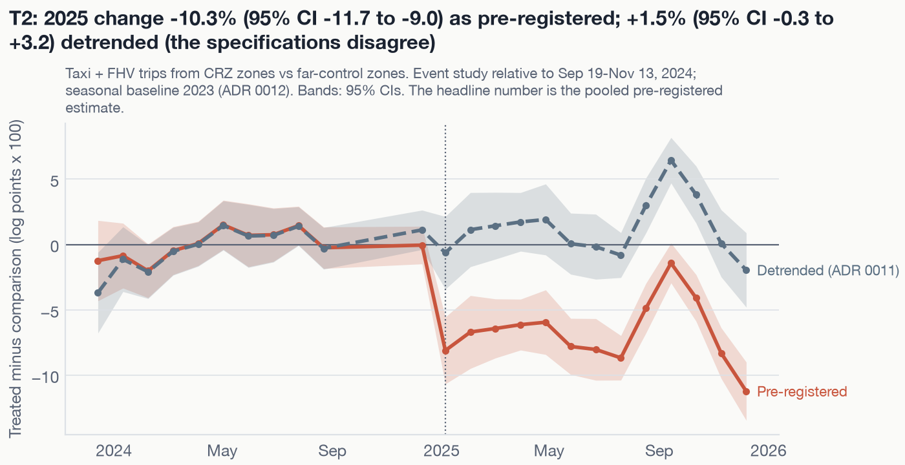

New York began tolling vehicles entering Manhattan at or below 60th Street on
**January 5, 2025**. Cordon asks what the toll changed:

- traffic and speeds;
- transit ridership;
- air quality;
- the neighbourhoods just outside the zone.

It answers with a pre-registered analysis of public data. The outcomes, comparison groups,
and decision rules were committed before any effect was estimated, and every later change
is logged.

::: {.callout-note appearance="simple"}
## The short version

- Taxi and ride-hail trips from the zone changed by **** relative to distant
  zones (95% CI ).
- Trip speeds in the zone changed by ****.
- Trips in the surrounding ring changed by ****. There is no sign of traffic
  pushed into nearby neighbourhoods.
- **None of these is robust.** The pre-period data violate the parallel-trends assumption the
  estimates rely on.
  - A placebo toll a year early (January 7, 2024) "finds"  for trips
    from the zone.
  - Of  claims,  are robust,
     fragile, and  not supported.
- **Subway ridership and air quality:** no detectable effect with these designs. The
  air-quality designs are limited by having only two usable monitors inside the zone.
:::

{.hero-figure fig-alt="Event-study chart: trips from the zone drop after January 2025 in the pre-registered specification but not in the detrended one."}

## Where to go next

| Page | What it covers |
|---|---|
| [Paper](paper.qmd) | The full write-up, with alternative explanations and limitations; also as PDF |
| [All results](results.qmd) | Every estimate, check, and label, generated from `results/` |
| [Methods](methods.qmd) | Pre-registration, designs, inference, and the 24 logged deviations |
| [Data](data.qmd) | Sources, coverage, and how to rebuild everything with `make all` |

## How to read the labels

| Label | Meaning |
|---|---|
| **Robust** | Significant after multiplicity adjustment, and passes every pre-registered check, including HonestDiD M̄ ≥ 1 |
| **Fragile** | Significant, but fails at least one check |
| **Not supported** | Not significant after adjustment, or the design's fit check failed |
