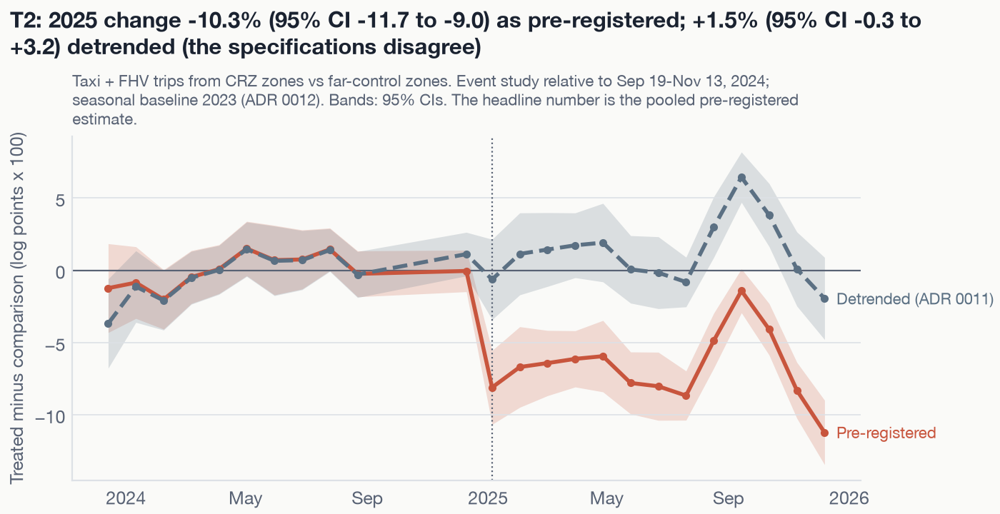

## The question and why it is hard

New York's Congestion Relief Zone (CRZ) is the first cordon toll in the United States:

- $9 for most passenger cars at peak hours, 75% less overnight;
- per-trip surcharges for taxis and ride-hail trips that touch the zone.

Early studies report fewer vehicles, faster speeds, and contested air-quality effects
[@cook2026; @fraser2025; @pandey2026; @dohmh2026]. Two questions remain hard:

1. **What would have happened without the toll?** Manhattan traffic was changing for other
   reasons: return-to-office mandates, ride-hail pricing, and post-pandemic recovery.
2. **What happened just outside the cordon?** Tolls can push trips into neighbouring
   streets, or pull trips out of them.

Cordon does two things:

- **Replicates** the headline traffic findings with transparent methods, on public data only.
- **Extends** them with spillover and equity analyses for the ring of border neighbourhoods,
  upper Manhattan, and the Bronx.

**Commitment to neutrality.** The topic is contested, so we report every pre-registered
estimate, including nulls and estimates that look unfavourable to the policy. Every effect
comes with its uncertainty. Every number in this paper is read from files generated by code
(`results/`); none is typed by hand.

## Pre-registration and design

Before any effect was estimated, the analysis plan (tag `analysis-plan-v1`) fixed:

- six primary outcomes, Holm-adjusted [@holm1979];
- the secondary families, BH-adjusted [@benjamini1995];
- the treated, spillover, and comparison geographies;
- the estimation windows;
- the rules for calling a claim robust.

One amendment (`analysis-plan-v1.1`), also made before any estimate, added a detrended
secondary specification for every design. The 24 deviations logged since then are each dated
and say whether they were made before or after the related estimates were seen.

**Geography.** Taxi zones are grouped by distance from the CRZ:

| Group | Taxi zones | Role |
|---|---|---|
| CRZ |  | treated |
| Border ring (≤ 3 km) |  | spillover |
| Upper Manhattan + Bronx |  | spillover |
| Intermediate band (3–8 km) |  | never a control |
| Far control (> 8 km) |  | comparison |

Keeping the intermediate band out of the comparison group is deliberate. Earlier work used
upper Manhattan as a control, which assumes no spillovers there.

**Windows.**

| Window | Dates |
|---|---|
| Baseline (pre-period) | 2023-01-01 to 2024-11-13 |
| Anticipation (after the program was revived) | 2024-11-14 to 2025-01-04 |
| Headline post-period | 2025 |
| Extended post-period (after the January 2026 fare and toll increases) | 2026 onward |

**Estimators.**

- **Difference-in-differences** with unit × week-of-year and date fixed effects. Every treated
  unit starts on the same date, so staggered-adoption bias does not arise.
- **Event studies**, using 2023 as the seasonal baseline (ADR 0012).
- **Synthetic control** for system-level outcomes, demeaned, with placebo-in-space inference
  [@abadie2010; @doudchenko2016; @ferman2021].
- **Inference:**
  - cluster-robust standard errors when there are 30 or more clusters;
  - restricted wild cluster bootstrap with Webb weights [@webb2014; @mackinnon2018] and
    randomization inference when there are fewer.
- **Detrended specification:** subtracts unit-specific linear trends fitted on the pre-period
  only, so post-period effects cannot bend the trend [@wolfers2006; @borusyak2024].
- **Sensitivity to parallel trends:** HonestDiD bounds [@rambachan2023], using a Python port
  validated against the R package's published example (20 of 20 interval endpoints match to
  two decimals).

**A simulation lesson.** Every estimator was tested on simulated data with known effects before
it touched real data. That testing caught one design flaw (ADR 0012). The event study as
written in the plan uses 28-day bins, and 13 of them span 364 days. The treated group's
seasonal pattern was then almost indistinguishable from the bin indicators, so seasonal noise
appeared as fake pre-trends. The pooled headline estimate was not affected.

## Results

### Traffic and speeds

Taxi and ride-hail trips starting in the CRZ changed by **** in 2025 relative to
far-away zones (95% CI ). By service:

- yellow-taxi trips ;
- high-volume ride-hail (FHVHV) trips ;
- shared-ride requests .

The yellow-taxi comparison should be read with care. Far-away zones see very few yellow-taxi
pickups, so its log(1 + trips) outcome is driven by small counts.

Peak-hour door-to-door speeds of trips within the zone changed by ****
(95% CI ). They rose more on weekends () than on
weekdays ().

Crossings at the two MTA tunnels that feed the zone changed by . With seven
facilities, randomization inference can never produce a p-value below 1/21, and the
Holm-adjusted p is .

{fig-alt="Event-study chart for T2. Bins before 2025 sit near zero relative to the reference window; after tolling the pre-registered series drops to about minus 6 to minus 8 log points, while the detrended series stays near zero."}

The figure shows why the detrended version disagrees:

- Relative to late 2024, the 2024 bins are flat.
- The gap between the zone and distant zones dropped between 2023 and early 2024, before any
  toll. The pooled estimate counts that drop; the detrended specification extends it forward
  as a trend and finds **** ().
- Measured against late 2024 only, the 2025 event-study average lies between
  .

The honest summary is a decline. Its size depends on how one treats a gap that was already
widening.

### Transit

- **Subway ridership vs other US rail systems** (synthetic control): a year-one gap of
   (Holm p = ). The design can detect effects of about
  % or larger, so smaller effects cannot be ruled out.
- **Station entries inside vs outside the zone:**  (95% CI
  ).
- **Bus ridership:** .
- **Peak bus speeds on route segments in the zone:** .

### Air quality

There is no open-data regulatory monitor with a pre-period inside the zone, and no NO₂ monitor
anywhere in Manhattan. The PM2.5 analysis therefore relies on two NYC Community Air Survey
sites.

- **Against out-of-region monitors** (synthetic control): the gap is . The
  pre-period fit fails the pre-registered check, so this is descriptive only.
- **Against Queens College, weather-adjusted:** , with randomization
  p =  over only six possible assignments.

Neither design can confirm or rule out the PM2.5 changes reported elsewhere [@fraser2025;
@dohmh2026].

### Spillovers

We find no sign of traffic or pollution displaced into neighbouring areas.

- **Border ring** (trips with both ends outside the zone):  (95% CI
  ). By borough: Manhattan , Brooklyn
  , Queens .
- **Upper Manhattan and the Bronx:** .
- **Speeds in the border ring:** .
- **Bridges that could absorb diverted traffic:** .
- **Bronx air quality:** PM2.5 at the Cross Bronx Expressway ; NO₂ at IS 52
  . Both are descriptive only, because their synthetic controls fit poorly.

**Equity (exploratory, not causal).** Zone-level spillover effects across
 zones were shrunk with empirical Bayes [@dersimonian1986].
Population-weighted correlations with the shrunk effects:

- median income ;
- share of households without a car ;
- poverty rate ;
- adult asthma ED visits .

These mostly reflect geography: Manhattan's ring zones are richer, less car-dependent, and
changed more.

### Replication of Pandey, Guler & Gayah (2026)

We re-ran their specification on the same public records:

- ride-hail pickups on weekdays, weeks 1–14;
- upper Manhattan zones as the control;
- a pooled 2×2 regression.

| | β (SE) |
|---|---|
| Published |  () |
| Our replication |  () |
| Far-away zones as the control |  () |

Our replication matches the published estimate closely. Swapping the control to far-away zones
gives a larger decline, consistent with upper Manhattan itself losing trips.

## How much should you believe this?

The labelling rules were fixed before any check was run. A claim is **robust** only if all of
the following hold:

- it is significant after multiplicity adjustment;
- it passes every falsification and re-estimation check;
- its HonestDiD breakdown M̄ is at least 1, so it survives post-period violations of parallel
  trends as large as the worst pre-period violation;
- for the flagged outcomes, the detrended specification agrees.



Three findings drive the labels:

1. **Pre-trends.** Every traffic design fails its joint pre-trend test. HonestDiD breakdown
   values are small:  for T2, and  for T3 and
   S1. Their estimates keep their sign only if post-period violations of parallel trends are
   at most a quarter to half the size of the largest pre-period one.
2. **Placebo dates.** A fake toll on January 7, 2024, estimated on pre-period data only,
   produces  for T2 and  for T3. That is a
   substantial "effect" a year before tolling. For S1 it is , small
   enough to pass.
3. **What does pass.** The traffic estimates keep their sign under every alternative
   comparison group and under dropped windows. The heterogeneity-robust imputation
   estimator could be computed for T1 and T2, and it agrees with them closely; for T3 and S1
   it could not be computed (non-imputable fixed-effect levels or a singular design). With
   the intermediate band as the control, T2 is  and S1 is
   . Smaller estimates there are what spillovers into
   nearby areas would produce.

## Alternative explanations

- **Return-to-office mandates** concentrated in Manhattan in 2025 push the zone's ride-hail
  demand up. That would bias trip reductions toward zero and transit gains upward.
- **The 2023→2024 shift** in the zone's share of trips predates the toll. If it reflects a
  continuing trend, part of the T2 estimate is not the toll. If it was a one-off level
  change, the pre-registered estimate is closer to the truth. The data cannot tell these
  apart.
- **The per-trip surcharge** is part of the policy. Ride-hail declines therefore combine a
  price effect and a congestion effect, not congestion alone. Consistent with this, T2 falls
  equally at peak () and overnight (), the
  same pattern a flat per-trip fee would produce.
- **Measurement.** TLC speeds are door-to-door speeds and include stops. NYCCAS sensors are
  corrected low-cost instruments, and only two sites inside the zone have a usable pre-period.

## Limitations

- **Public data only.** There are no road-segment speeds before 2025, no Port Authority
  crossings, and no NO₂ inside Manhattan.
- **Not estimated in v1:** four secondary outcomes (MTA zonal speeds, DOT link speeds,
  PATH/NJ Transit ridership, and Citi Bike).
- **Few clusters** for the facility and air-quality designs limit their power by construction.
- **The equity analysis** describes associations, not effects.

## Reproducibility

`make all` rebuilds every number from raw public downloads:

- every input is checksummed in `data/MANIFEST.json`;
- every estimator is unit-tested on simulated data;
- HonestDiD and DoWhy run in pinned, isolated environments.

Code, the analysis plan, ADRs, and the deviations log are at
<https://github.com/Gnanasudharsan/nyc-congestion-pricing-causal-impact>.

## References {.unnumbered}

::: {#refs}
:::
