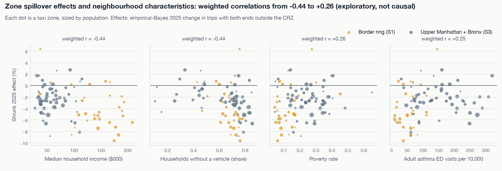
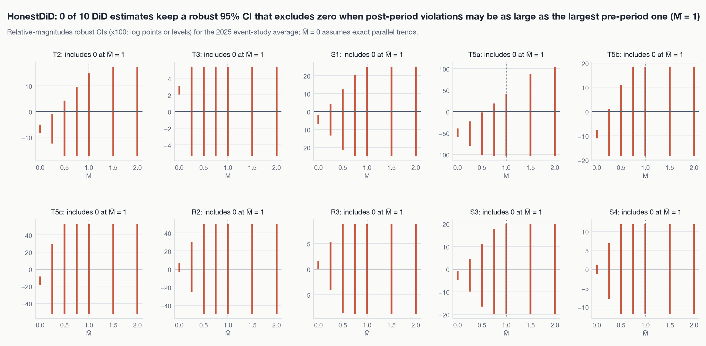

## Claim labels



## Primary outcomes

Holm adjustment across the six primary outcomes:



Difference-in-differences: headline (2025), detrended, anticipation, and extended windows.



Synthetic control:



## Secondary outcomes





## Spillovers







## Explore the event studies



## Heterogeneity



## Zone-level spillovers and the equity lens (exploratory)



{fig-alt="Four scatter panels of zone effects against income, car-free households, poverty and asthma ED visits; border-ring zones in orange, upper Manhattan and Bronx zones in grey."}

## Robustness



{fig-alt="Small multiples of robust confidence intervals widening with M-bar; all include zero by M-bar of one."}





## Replication and cross-checks




